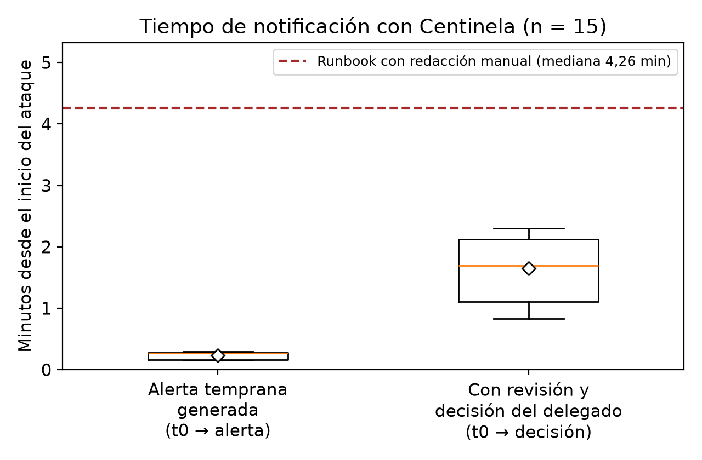
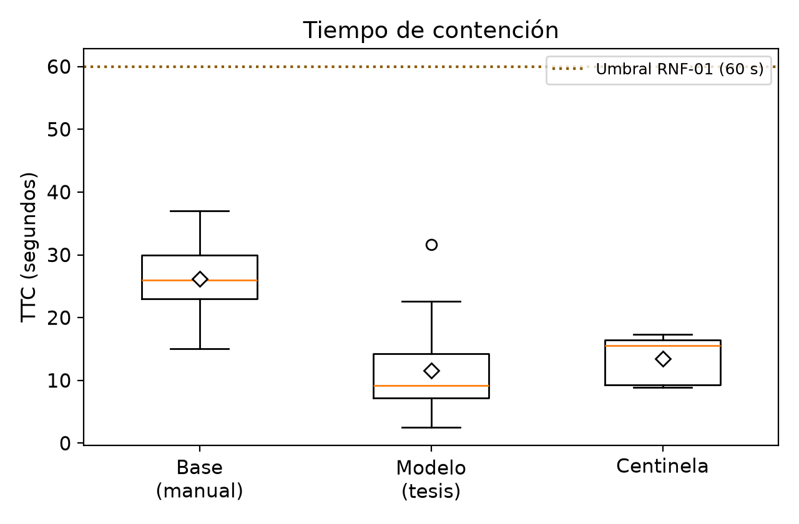
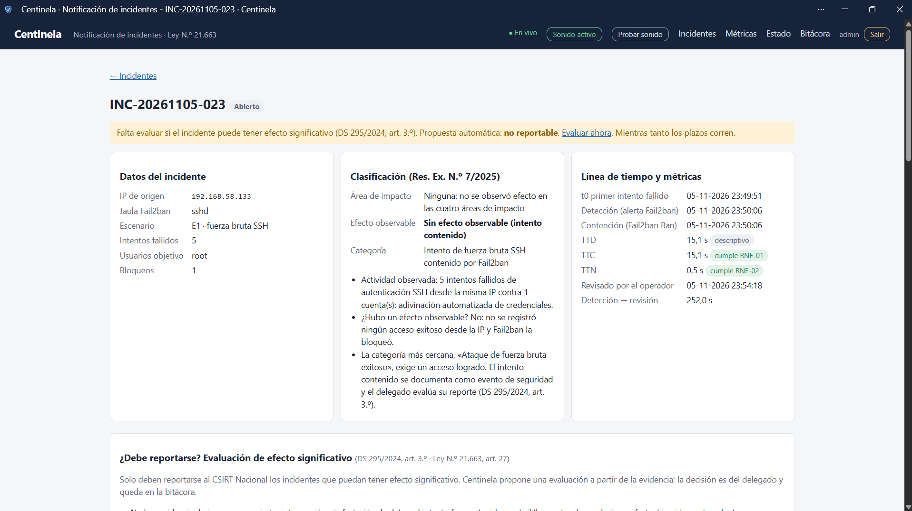

# Modelo de gestión y respuesta a incidentes bajo la nueva Ley de Ciberseguridad en Chile

Repositorio de evidencias, código y configuración de la tesina **"Modelo de
gestión y respuesta a incidentes bajo la nueva Ley de Ciberseguridad en Chile"**.

- **Autores:** Nicolás Francisco Torres Sandoval · Benjamín Ignacio Alegría Prieto
- **Profesor guía:** Cristian Lorenzo Vidal Silva
- **Institución:** Universidad Bernardo O'Higgins — Ingeniería en Informática
- **Año:** 2026

## Objetivo
Diseñar y evaluar un modelo operativo (runbook + contención automatizada) que
permita a operadores de servicios esenciales cumplir los plazos y la taxonomía
de la ANCI, midiendo experimentalmente la reducción del **tiempo de contención (TTC)**
y del **tiempo de notificación (TTN)**.

## Estructura del repositorio
```
centinela/      Herramienta propia de gestión y notificación de incidentes (ver abajo)
runbook/        Runbook de respuesta a incidentes (ISO 27035 / NIST 800-61)
config/         Configuración real del entorno (Fail2ban, SSH, NTP)
scripts/        Medición del escenario E1 y utilidades de reset/extracción
data/           Datos crudos: TTC (15 base + 15 modelo) y TTN con Centinela (15)
analysis/       Análisis estadístico (Mann-Whitney, Wilcoxon, tamaño de efecto, figuras)
results/        Figuras y salidas del análisis
plantillas/     Plantillas de reporte a la ANCI (condición modelo, redacción manual)
casos_prueba/   Casos de prueba CP-01 a CP-07 (verificación de RF/RNF)
taxonomia/      Lista de verificación para clasificar incidentes (Res. Ex. 7/2025)
```

## Centinela: herramienta de notificación de incidentes

`centinela/` contiene la herramienta desarrollada en la tesina. Integra las
herramientas evaluadas (Fail2ban, iptables y las bitácoras `auth.log`,
`access.log` y `fail2ban.log`) y automatiza la gestión del incidente desde el
bloqueo hasta los reportes al CSIRT Nacional:

- **Detección y contención:** recibe cada bloqueo de Fail2ban mediante una acción
  propia y lee la evidencia de las bitácoras, en los escenarios E1 (SSH) y E2 (web).
- **Clasificación oficial:** usa la taxonomía de la Res. Ex. N.º 7/2025 (4 áreas,
  11 efectos observables, 40 categorías). Detecta la fuerza bruta exitosa y la
  exposición de `.git`, `.env` o respaldos, y escala el incidente si se agrava.
- **Evaluación del deber de reportar:** propone si el incidente tiene efecto
  significativo según el DS 295/2024, art. 3.º, letras a) a e). El delegado
  decide y su justificación queda registrada.
- **Reportes:**
  - genera la alerta temprana en PDF al instante y prellena el segundo reporte,
    el plan de acción y el informe final con el contenido mínimo de los arts. 5.º
    y 9.º a 12;
  - omite los datos personales (art. 6.º);
  - registra el folio de la plataforma ANCI.
- **Plazos legales:**
  - 3 h para la alerta temprana;
  - 24 o 72 h para el segundo reporte;
  - 7 días para el plan de acción (solo OIV);
  - 15 días para el informe final, contados desde el envío de la alerta.

  Avisa por correo y en el panel cuando un reporte está por vencer o vence.
- **Avisos en tiempo real:** panel web HTTPS en vivo, alarma sonora hasta que se
  revisa el incidente, notificaciones de escritorio y correo al delegado con el
  PDF adjunto.
- **Registro manual** de incidentes que Fail2ban no detecta (ransomware, caídas,
  phishing), con el mismo flujo.
- **Integridad y seguridad:**
  - huellas SHA-256 de la evidencia y de los PDF, y bitácora de auditoría encadenada;
  - inicio de sesión con scrypt, bloqueo por fuerza bruta, CSRF y CSP estricta;
  - página de estado del sistema.

Instalación en la máquina víctima, sin conexión a Internet:
`sudo bash centinela/instalar.sh`. Documentación:
[manual de usuario](centinela/docs/manual_usuario.md),
[manual técnico](centinela/docs/manual_tecnico.md) (incluye la trazabilidad
normativa) y
[protocolo de mediciones](centinela/docs/protocolo_mediciones.md).
Tiene 52 pruebas automáticas: `cd centinela && python -m pytest`.

## Cómo reproducir el experimento
1. **Entorno:** VMware Workstation con `victima-02` (Ubuntu + OpenSSH + Apache + Fail2ban)
   y `Kali Linux` (Nmap, Nikto, Gobuster, THC-Hydra), en red aislada.
2. **Configuración:** aplicar los archivos de `config/` y sincronizar relojes por NTP.
3. **Medición:** en `victima-02`, ejecutar 15 veces por condición:
   ```bash
   sudo ./scripts/medir_e1.sh base   1 A     # condición base (bloqueo manual)
   sudo ./scripts/medir_e1.sh modelo 1 A     # condición modelo (Fail2ban)
   ```
4. **Análisis:**
   ```bash
   pip install -r analysis/requirements.txt
   python analysis/analisis_ttc.py
   ```
5. **Mediciones del TTN con Centinela:** seguir
   [`centinela/docs/protocolo_mediciones.md`](centinela/docs/protocolo_mediciones.md)
   (15 ejecuciones de E1). Luego exportar las métricas desde el panel y analizarlas:
   ```bash
   python analysis/analisis_ttn_centinela.py data/metricas_centinela_exportacion_completa.csv --desde "2026-11-05 21:20" --hasta "2026-11-05 23:45"
   ```

## Justificación de las herramientas
| Herramienta | Por qué se eligió |
|---|---|
| **VMware Workstation** | Permite instantáneas (S0/S1) para reiniciar a un estado idéntico entre ejecuciones, clave para la repetibilidad. |
| **Fail2ban** | IPS de código abierto estándar que correlaciona logs y bloquea en el cortafuegos; materializa la contención automatizada del modelo. |
| **THC-Hydra** | Herramienta estándar de fuerza bruta; genera el vector E1 de forma controlada y parametrizable. |
| **Nmap / Nikto / Gobuster** | Reconocimiento y enumeración estándar de la industria; generan el escenario E2 y la actividad previa. |
| **OpenSSH + Apache** | Servicios reales y ubicuos en operadores de servicios esenciales; dan validez al escenario. |
| **Python + SciPy** | Estándar científico para la prueba U de Mann-Whitney y el tamaño de efecto, con resultados reproducibles. |
| **Python + Flask + reportlab (Centinela)** | Lenguaje del análisis del estudio; Flask permite un panel web liviano y reportlab genera los PDF de los reportes sin servicios externos. |

## Resultados principales (TTC)
- Mediana TTC: **26,0 s (base) -> 9,2 s (modelo)** = **reducción del 64,6 %**
- U de Mann-Whitney (unilateral): **U = 18,0; p = 4,75 × 10⁻⁵**
- Tamaño del efecto: **r = 0,84** (efecto grande)

## Resultados con Centinela (TTN, 15 ejecuciones del escenario E1)
Datos: [`data/ttn_centinela_15_ejecuciones.csv`](data/ttn_centinela_15_ejecuciones.csv) ·
detalle completo: [`results/resultados_centinela.md`](results/resultados_centinela.md).

| Métrica | Mediana | Comparación |
|---|---|---|
| TTN total (t0 → alerta temprana completa) | **15,9 s (0,27 min)** | 4,26 min con runbook y redacción manual (Tabla N.º 17): **−93,8 %** |
| t0 → decisión del delegado (incluye revisión humana) | **1,69 min** | **−60,2 %** respecto de 4,26 min; máximo 2,30 min |
| TTC | 15,6 s | Base manual 26,0 s (U = 18,0; p = 4,77 × 10⁻⁵; r = 0,84) |

- Wilcoxon de una muestra, unilateral (H1: mediana < 4,26 min): **p = 3,05 × 10⁻⁵**,
  tanto para el TTN total como para la cadena con decisión humana.
- Cumplimiento: RNF-01 (TTC ≤ 60 s) 15/15 · RNF-02 (TTN ≤ 180 min) 15/15 · RF-04
  (alerta con todos los campos) 15/15; IC 95 % de Wilson: 79,6–100 %.
- Todas las marcas de tiempo provienen del reloj de `victima-02` (bitácoras y
  servidor de Centinela, sincronizado por NTP), sin cronómetro manual.
- Como la tesina solo publica la mediana del TTN de la Tabla N.º 17, el TTN se
  compara contra ella con la prueba de Wilcoxon de una muestra.
- La ejecución 15 empezó 161 s después de la anterior, por debajo de los 3 min
  del protocolo pero por encima del `findtime` de 120 s, que es lo que separa
  técnicamente las ejecuciones.




## Evidencia visual
- [`results/figuras_tesis/`](results/figuras_tesis/): figuras del desarrollo
  experimental de la tesina (entorno VMware, reconocimiento, Apache, Nikto,
  Gobuster, Hydra, `auth.log` y Fail2ban).
- [`results/capturas_centinela/`](results/capturas_centinela/): funcionamiento de
  Centinela, desde el ataque hasta la alerta temprana, el correo, la evaluación,
  la bitácora y el estado del sistema.



## Licencia
Código y configuración bajo licencia MIT (ver `LICENSE`). Documentos y datos de la
tesina: uso académico.
